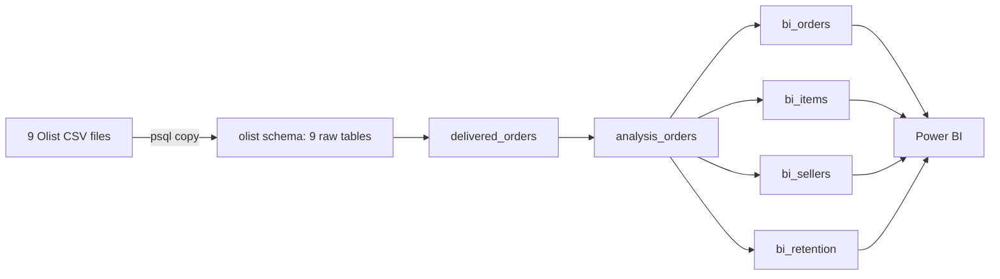
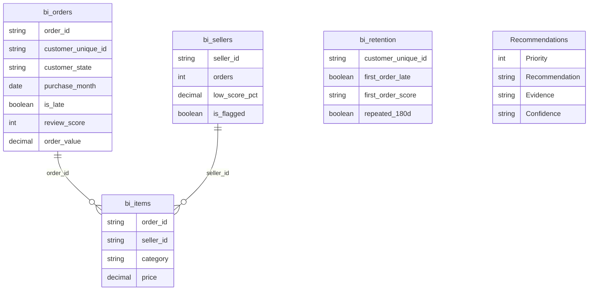
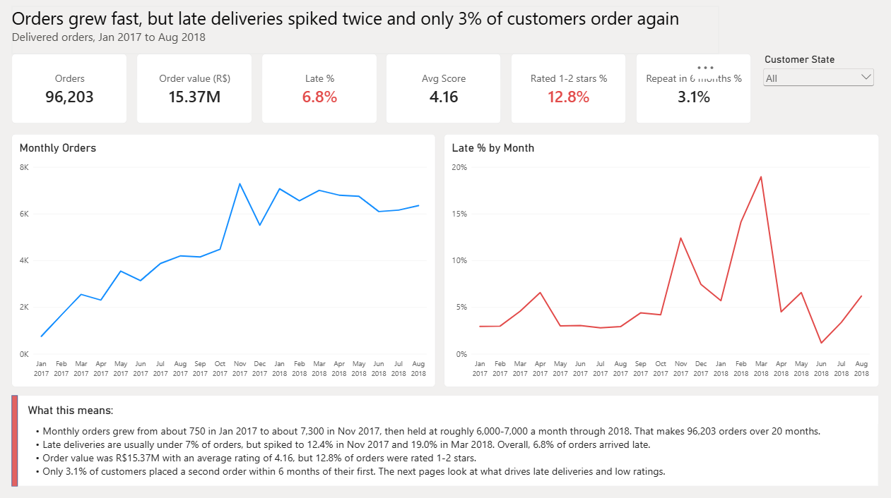
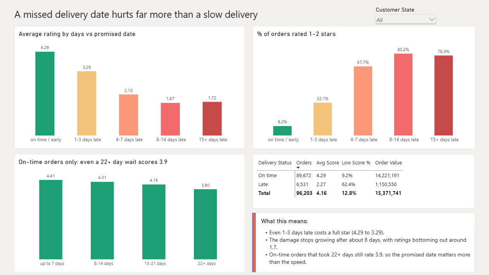
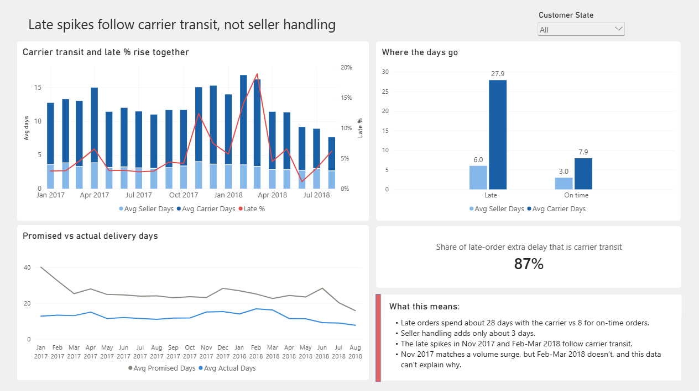
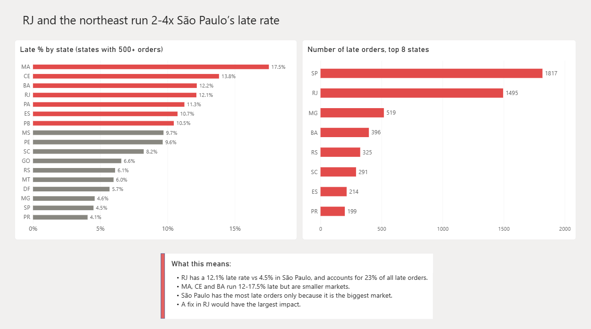
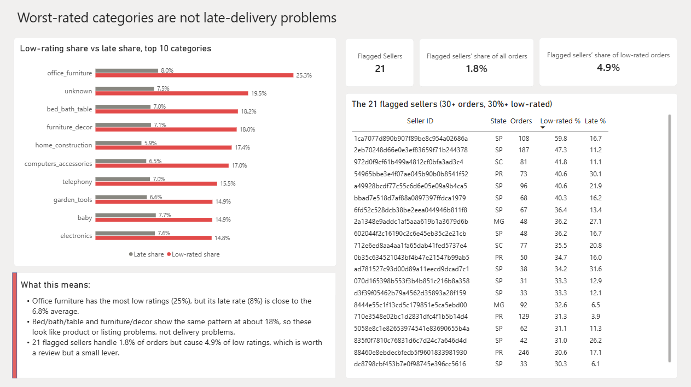
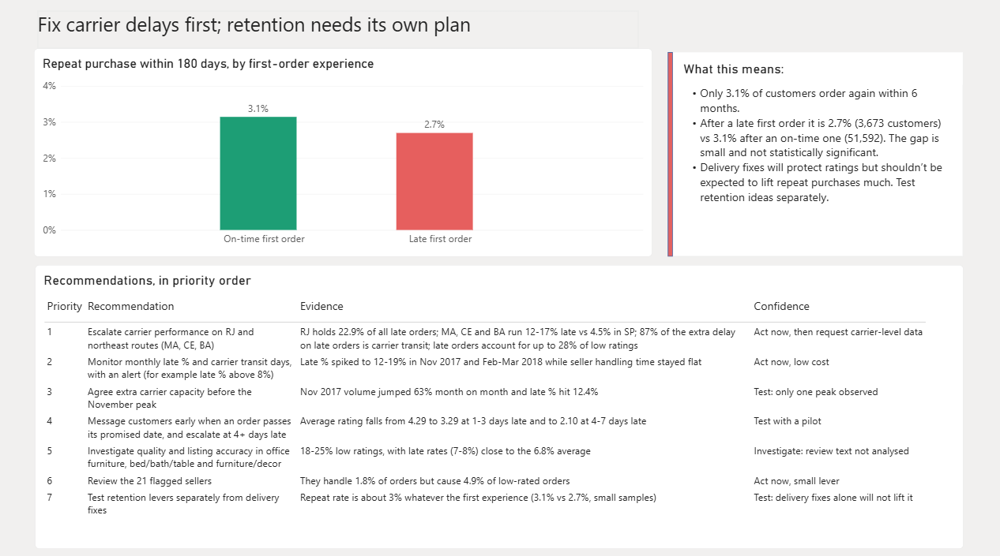

# Olist E-Commerce: Delivery Performance and Customer Satisfaction

Do late deliveries drive bad reviews, where do the delays come from, and do they stop customers from buying again? I cleaned and analysed 96,203 delivered orders from a Brazilian marketplace in PostgreSQL, then built a six-page Power BI dashboard that ends in prioritised recommendations.

## Questions answered

- How much worse do customers rate late orders?
- Does a slow delivery hurt, or only a missed delivery date?
- Where do the days go: seller handling or carrier transit?
- Which states and months are worst?
- Are the worst-rated categories and sellers delivery problems?
- Does a late first order reduce repeat purchases?

## Key findings

- **6.8% of orders arrive late** and average 2.27 stars vs 4.29 for on-time orders. 62.4% of late orders are rated 1-2 stars, vs 9.2% of on-time orders.
- **A missed date hurts more than a slow delivery.** Ratings drop a full star at just 1-3 days late (4.29 to 3.29) and level off after about 8 days. On-time orders that took 22+ days still score 3.90.
- **About 87% of the extra delay on late orders is carrier transit**, not seller handling. Late orders spend 27.9 days with the carrier vs 7.9 for on-time orders; seller handling adds about 3 days.
- **Lateness comes in spikes.** Late % is normally 3-6% but reached 12.4% in Nov 2017 and 19.0% in Mar 2018. The Nov 2017 spike matches a volume surge; the Feb-Mar 2018 one does not, and the data cannot explain it.
- **RJ has a 12.1% late rate vs 4.5% in São Paulo** and holds about 23% of all late orders. MA, CE and BA run 12-17.5% late.
- **Office furniture has the most low ratings (25%) with a normal late rate (8%)**, which suggests a product or listing problem (review text was not analysed).
- **21 flagged sellers** (30+ orders and 30%+ rated 1-2 stars) handle 1.8% of orders but cause 4.9% of low ratings: worth a review, but a small lever.
- **Only 3.1% of customers buy again within 180 days** (2.7% after a late first order vs 3.1% after an on-time one). The gap is small and not statistically significant (z of about 1.5), so delivery does not clearly explain the low repeat rate.
- About 15% of order value (R$2.3M of R$15.4M) sits in orders rated 1-2 stars. This is value in unhappy orders, not lost revenue.

## Dataset

[Brazilian E-Commerce Public Dataset by Olist](https://www.kaggle.com/datasets/olistbr/brazilian-ecommerce) on Kaggle: real, anonymised orders from 2016 to 2018 in 9 CSV files. 

| Table | Rows | Used here |
|---|---|---|
| orders | 99,441 | Yes |
| order_items | 112,650 | Yes |
| order_reviews | 99,224 | Yes |
| customers | 99,441 | Yes |
| products | 32,951 | Yes |
| sellers | 3,095 | Yes |
| category_translation | 71 | Yes |
| order_payments | 103,886 | No |
| geolocation | 1,000,163 | No |

## Tools

| Tool | Used for |
|---|---|
| PostgreSQL | Raw tables, cleaning views, analysis queries and the views Power BI reads |
| DBeaver | SQL client for writing and running the queries |
| psql (`\copy`) | Loading the CSV files (the reviews file has multi-line comments that the DBeaver import wizard cannot read) |
| Power BI Desktop | Data model, DAX measures, calculated columns and the dashboard (Import mode) |

SQL techniques: CTEs, window functions (`ROW_NUMBER`, `SUM() OVER`), `DISTINCT ON`, conditional aggregation with `FILTER`, views, date arithmetic, cohort logic.

## Approach

1. **Choose the data first, then the question.** I picked a multi-table dataset and then chose a business question it can genuinely answer, instead of forcing a scenario onto unsuitable data.
2. **Load the raw data untouched** into PostgreSQL and verify every row count.
3. **Profile and check quality** before analysing anything.
4. **Clean in views, not in the raw tables**, so every rule is visible and repeatable.
5. **Investigate:** delivery vs satisfaction, where the delay happens, where problems concentrate, repeat purchase, and the value at stake.
6. **Build the dashboard** so each page proves its own title, then turn the findings into prioritised recommendations with a confidence level.

## What I did

### 1. SQL: profile, clean and analyse

The raw tables had issues, so I cleaned them in SQL before any analysis:

| Raw data | What I did |
|---|---|
| 99,441 orders, but only 96,478 are delivered | Kept delivered orders only (lateness needs a delivery outcome) |
| 8 orders are marked "delivered" but have no delivery date (the other 2,957 without one are not delivered) | Excluded the 8 |
| Orders run Sep 2016 to Oct 2018, with almost no orders in late 2016 and Sep-Oct 2018 | Used full months, Jan 2017 to Aug 2018 |
| 551 orders have more than one review | Kept the latest review per order |
| `customer_id` is new for every order (3,345 repeat-customer rows) | Used `customer_unique_id` to identify real customers |
| 610 products have no category (1,535 items in the analysis window); 2 categories have no English name | Labelled them "unknown" or kept the original name |
| 166 orders have a carrier pickup date before the purchase date | Left them out of seller-handling and carrier-transit averages only |
| 775 orders have no items; 9 zero-value and 3 undefined payments | No impact: the orders are non-delivered, and payments are not used |
| Invalid dates or prices | None found |

Order funnel: 99,441 raw orders → 96,478 delivered → 96,470 with a delivery date → **96,203 placed Jan 2017 to Aug 2018 (the analysis set)**.

I then wrote the analysis queries (late vs on-time ratings, rating by days late, on-time orders by delivery time, repeat purchase, seller concentration and flagging, late orders by state, categories, sizing, money at stake) and built the views Power BI reads.

### 2. What I created in SQL

| View | One row per | Purpose |
|---|---|---|
| `delivered_orders` | order | The cleaning rules applied once: delivered with a date, latest review only, real customer ID, late flag |
| `analysis_orders` | order | Restricts to Jan 2017 - Aug 2018 |
| `bi_orders` | order | Dashboard fact table: delay buckets, order sequence per customer, seller handling days, carrier transit days, promised days, order value |
| `bi_items` | item sold | Category and seller analysis |
| `bi_sellers` | seller | Seller quality stats and the flagged-seller rule |
| `bi_retention` | customer | First-order cohort: was the first order late, how was it rated, did the customer return within 180 days |

Resulting sizes: `bi_orders` 96,203 rows, `bi_items` 109,872, `bi_sellers` 2,945 (21 flagged), `bi_retention` 55,265.

The whole workflow is in one file, `sql/olist_analysis.sql`, in seven parts: create tables, load, profile and quality checks, cleaning views, analysis queries, BI views, final checks.

### 3. Power BI: model and dashboard

Power BI loads the four views as they are, with no Power Query transformations. In Power BI I added the relationships, the DAX measures (late %, average score, rated 1-2 stars %, repeat %, carrier share of extra delay, flagged sellers and more), calculated columns (for example Delivery Status, Delay Label and Month Label), a Recommendations table, and the six dashboard pages.

## Data model

`bi_items` links to `bi_orders` (by `order_id`) and to `bi_sellers` (by `seller_id`), one-to-many with single-direction filters.

Two tables are deliberately not connected:

- **`Recommendations`** is a static text table with nothing to join to.
- **`bi_retention`** is a one-row-per-customer cohort table built in SQL, used only for the retention chart and card. It has a different grain from the order table and only covers customers whose first order was before Mar 2018 (so each had 180 days to return), so linking it would mix the two. The consequence is that the state slicer does not filter it.

This is a light model rather than a full star schema, because the SQL views already clean and pre-join the data.

## Dashboard

### 1. Executive Summary
**Question:** How big is the marketplace, and where do late deliveries and repeat purchase stand?

**Takeaway:** Orders grew fast through 2017, late deliveries spiked twice (Nov 2017 and Mar 2018), and only 3.1% of customers order again.

### 2. Delivery vs Satisfaction
**Question:** How much does lateness hurt ratings, and at what point?

**Takeaway:** A missed date hurts more than a slow delivery. Even 1-3 days late costs a full star, while on-time orders that took 22+ days still score 3.9.

### 3. Where the Delay Happens
**Question:** Do late orders lose time with sellers or carriers?

**Takeaway:** Late orders spend 27.9 days with the carrier vs 7.9 for on-time orders. Seller handling adds only about 3 days.

### 4. Geography
**Question:** Which states are worst, and where are most late orders?

**Takeaway:** RJ and the northeast run 2-4x São Paulo's late rate, and RJ holds about 23% of all late orders.

### 5. Categories and Sellers
**Question:** Are low ratings a delivery problem, a product problem or a seller problem?

**Takeaway:** The worst-rated categories have normal late rates, so they are not delivery problems. 21 flagged sellers cause 4.9% of low ratings, a small lever.

### 6. Recommendations
**Question:** Does a bad first order reduce repeat purchase, and what should the business do?

## Limitations

What the dataset does not contain, so it was not analysed:

- No carrier names, so carriers cannot be compared. Carrier transit is measured as a total only.
- No returns, refunds or costs, so there is no ROI estimate. Review text exists but was not analysed, so the reasons behind bad reviews are not measured.

Choices made in the analysis:

- Only delivered orders are analysed (Jan 2017 to Aug 2018). Jun to Aug 2018 may look better than it was, because orders not yet delivered are excluded.
- About 640 delivered orders (under 1%) have no review and are left out of rating figures.
- The data covers 20 months, so only one November peak is observed and seasonality cannot be confirmed. The Feb-Mar 2018 spike is unexplained.
- Repeat purchases are tracked per customer ID and cannot see a customer returning under a different account. The repeat-rate difference between late and on-time first orders is small and not statistically significant.
- Order value is item price plus freight, in the dataset's local currency (R$). Category counts count multi-item orders once per item.
- Results show association, not proof of cause.

